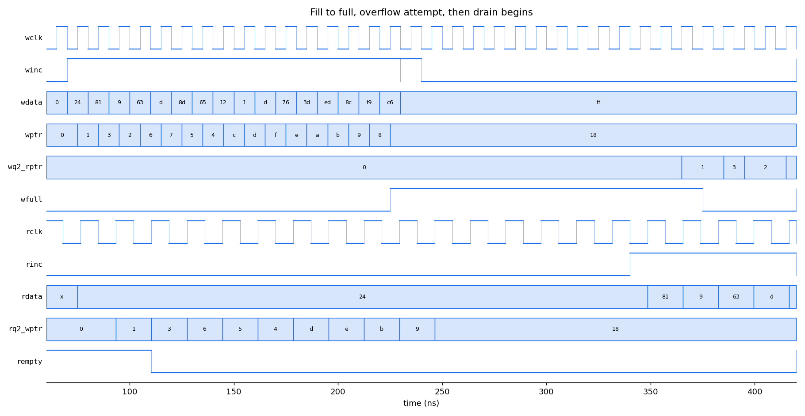

# Parameterized Asynchronous FIFO

## Overview

Designed and implemented a parameterized asynchronous FIFO in
SystemVerilog for reliable data transfer between independent
clock domains.

## Features

- Parameterized data width and FIFO depth
- Independent read and write clock domains
- Binary and Gray-code pointers
- Two-flop CDC synchronizers
- Full and empty detection
- Reset handling
- SystemVerilog verification environment

## Architecture

```text
            write clock domain                     read clock domain
        +----------------------+               +----------------------+
 winc ->|      wptr_full       |  wptr (Gray)  |  sync_2ff (w2r)      |
        |  wbin -> waddr       |-------------->|  -> rq2_wptr         |
 wfull<-|  wgray -> wptr       |               |                      |
        +----------------------+               |     rptr_empty       |<- rinc
        |  sync_2ff (r2w)      |  rptr (Gray)  |  rbin -> raddr       |
        |  -> wq2_rptr         |<--------------|  rgray -> rptr       |-> rempty
        +----------------------+               +----------------------+
                   |  waddr, wdata, wen               |  raddr
                   v                                  v
              +------------------------------------------+
              |      fifo_mem  (2**ADDR_WIDTH x DATA)    | -> rdata
              +------------------------------------------+
```

The FIFO uses independent read and write pointers operating in
separate clock domains. Gray-coded pointers are synchronized across
clock domains using two-stage synchronizers.

| Module | Description |
| --- | --- |
| [`async_fifo.sv`](rtl/async_fifo.sv) | Top level, wires the blocks together |
| [`fifo_mem.sv`](rtl/fifo_mem.sv) | Dual-port memory: synchronous write, combinational read |
| [`wptr_full.sv`](rtl/wptr_full.sv) | Write pointer (binary + Gray) and registered `wfull` |
| [`rptr_empty.sv`](rtl/rptr_empty.sv) | Read pointer (binary + Gray) and registered `rempty` |
| [`sync_2ff.sv`](rtl/sync_2ff.sv) | Two-flop pointer synchronizer |

### Parameters

| Parameter | Default | Meaning |
| --- | --- | --- |
| `DATA_WIDTH` | 8 | Word width in bits |
| `ADDR_WIDTH` | 4 | Depth = `2**ADDR_WIDTH` (16 by default) |

### Design notes

- Pointers are `ADDR_WIDTH+1` bits wide. The extra MSB tells a full FIFO
  (same address, different wrap) apart from an empty one (identical pointers).
- **Empty**: next Gray read pointer equals the synchronized Gray write pointer.
- **Full**: next Gray write pointer equals the synchronized Gray read pointer
  with its two MSBs inverted.
- Only one bit of a Gray pointer changes per increment, so even if a
  synchronizer samples during a transition, the receiving domain sees either
  the old or the new value, never a corrupt one.
- Flags are *pessimistic*: because the opposite pointer arrives two cycles
  late, `wfull` may stay high, and `rempty` may stay high, for a couple of
  cycles longer than strictly needed. They never assert late, so the FIFO
  can't overflow or underflow.
- `rdata` is first-word-fall-through: valid whenever `rempty` is low.
- Writes while full and reads while empty are ignored.
- Each domain has its own active-low asynchronous reset (`wrst_n`, `rrst_n`).
  Reset both together to clear the FIFO.

## Verification

The self-checking testbench ([`tb/tb_async_fifo.sv`](tb/tb_async_fifo.sv))
keeps a queue-based reference model: every accepted write is pushed, every
accepted read is popped and compared with `rdata`. It also checks that the
model never holds more than `DEPTH` entries.

| # | Test | What is checked |
| --- | --- | --- |
| 1 | Reset | `rempty=1`, `wfull=0` |
| 2 | Fill to full | exactly `DEPTH` writes accepted before `wfull`; overflow write ignored |
| 3 | Drain to empty | data order, exactly `DEPTH` reads; underflow read ignored |
| 4 | Simultaneous read/write | 3 x 2000 cycles of random traffic: write-heavy, read-heavy, balanced |
| 5 | Reset mid-traffic | flags return to reset values, FIFO usable afterwards |
| 6 | Boundary / wrap-around | 4 back-to-back fill/drain cycles so both pointers wrap |

### Results

Default configuration (8-bit x 16, wclk 100 MHz, rclk 58.8 MHz) -
[`results/sim.log`](results/sim.log):

```text
writes accepted : 2006
reads accepted  : 1997      (9 words discarded by the mid-stream reset)
writes blocked by full : 1367
reads blocked by empty : 1283
TEST PASSED
```

Regression across widths, depths and clock ratios -
[`results/regression.log`](results/regression.log):

| Config | Width | Depth | wclk | rclk | Result |
| --- | --- | --- | --- | --- | --- |
| fast-write | 8 | 16 | 10 ns | 17 ns | PASS |
| fast-read | 8 | 16 | 17 ns | 10 ns | PASS |
| equal-clocks | 16 | 4 | 10 ns | 10 ns | PASS |
| 7x ratio | 32 | 8 | 6 ns | 42 ns | PASS |
| 7x ratio (reversed) | 32 | 8 | 42 ns | 6 ns | PASS |
| deep, slow write | 8 | 64 | 26 ns | 8 ns | PASS |
| minimum depth | 4 | 2 | 10 ns | 13 ns | PASS |

As a sanity check that the testbench catches real bugs, breaking the full
comparison in `wptr_full.sv` (inverting one MSB instead of two) makes the
default run fail with thousands of errors.

Waveform: writing until full, the ignored overflow write (`wdata=ff`),
and the read side starting to drain. Note the two-cycle lag of
`rq2_wptr` / `wq2_rptr` and the Gray-coded pointer values.



Synthesis (Yosys, generic gates, 8 x 16) - [`results/synth_stat.txt`](results/synth_stat.txt):
128 enable-flops for storage, 40 flops for pointers / flags / synchronizers,
no latches.

## How to run

Requires Icarus Verilog 12+ (`-g2012`).

```bash
make sim                                  # default config, writes results/sim.log + VCD
make sim ADDR_WIDTH=3 DATA_WIDTH=16 WCLK_HALF=9.0 RCLK_HALF=4.0
make regress                              # all configurations above
make wave                                 # open the VCD in GTKWave
make lint                                 # Verilator lint
python scripts/plot_vcd.py results/async_fifo.vcd out.png --start 60 --end 420 \
    --signals tb_async_fifo.wclk tb_async_fifo.winc tb_async_fifo.wfull
```

Without `make`:

```bash
iverilog -g2012 -o sim.vvp -s tb_async_fifo rtl/*.sv tb/tb_async_fifo.sv
vvp -n sim.vvp
```

## Tools

- SystemVerilog
- Icarus Verilog / Verilator
- Yosys (synthesis check)
- GTKWave / Python + matplotlib (waveforms)

## Repository Structure

```text
rtl/        - RTL source files
tb/         - Testbench
scripts/    - Regression and waveform-plotting scripts
results/    - Simulation results and waveforms
```

## References

C. E. Cummings, "Simulation and Synthesis Techniques for Asynchronous FIFO
Design", SNUG 2002.
